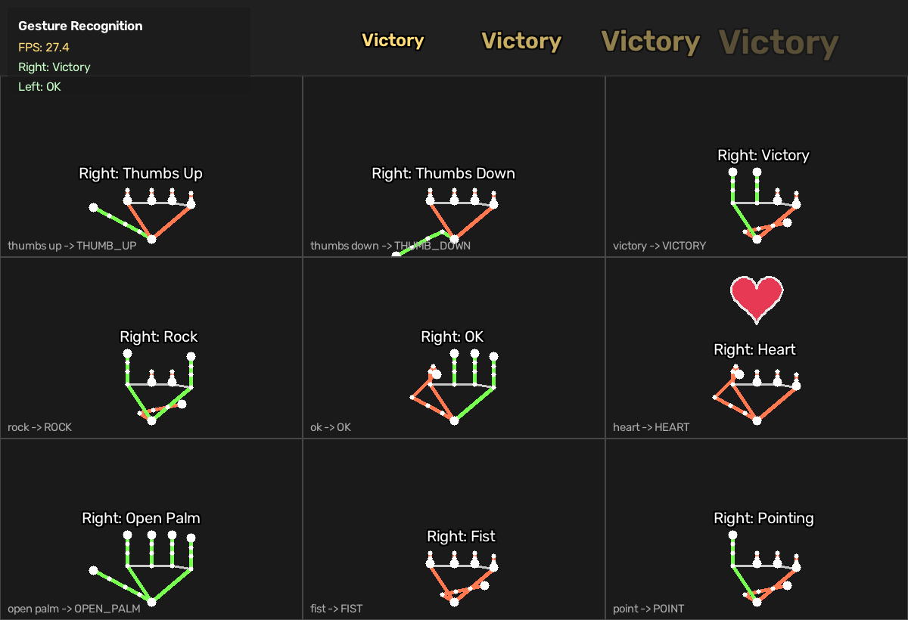

# AI Embedded Systems — ROS2 workspace

Working code for both lab sessions in this folder:

| Package | Covers |
|---|---|
| `village_li` | Lab 2 §2.4 — first Python node, procedural and object-oriented |
| `callback_demo` | Lab 2 §2.6 — timer callback publisher + message callback subscriber |
| `turtle_patrol` | Lab 1 Q1 — custom turtle trajectories (square / star / flower / spiral …) |
| `gesture_recognition` | **Experiment 2** — MediaPipe hand gesture recognition over the `/image` topic |
| `cyberdog_gesture_bridge` | Gestures → CyberDog locomotion commands over LCM |

Answers to the written lab questions are in [`ANSWERS.md`](ANSWERS.md).

## Final demo (10/2026): hand gestures drive the CyberDog in Gazebo

```
webcam ──/image (30 fps)──▶ gesture_node ──/gesture/hand──▶ bridge_node ──LCM──▶ cyberdog_control ──▶ Gazebo 11
           ROS 2 Jazzy        MediaPipe HandLandmarker        8-frame hold        (MPC + WBC, 500 Hz)
                              21 landmarks + left/right        1.5 s cooldown
                              joint angle + reach rule
                              5-frame majority vote
```

- **Recognition**: MediaPipe HandLandmarker (Tasks API; falls back automatically because newer
  MediaPipe dropped `mp.solutions`). Each finger counts as extended from its joint angle and its reach,
  scaled by hand size, so it works near or far from the camera. A 5-frame majority vote smooths flicker.
- **Bridge**: a gesture has to hold for 8 frames before it becomes a command, then a 1.5 s cooldown
  stops repeated triggers. Commands go out over LCM on the same multicast channel the physical robot uses.
- **Setup**: ROS 2 Jazzy runs on the Linux host (camera, MediaPipe, bridge). The CyberDog simulator
  (ROS 2 Galactic + Gazebo 11 + LCM, from MiRoboticsLab's `cyberdog_sim`) runs in Docker.

| Gesture | Robot |
|---|---|
| ✋ Open palm | walk |
| ✊ Fist | stop and sit |
| ✌️ Victory, left / right hand | turn left / right |
| 👍 Thumbs up | stand on two legs |
| ☝️ Point | shake paw |

The sections below are the original lab setup (Ubuntu 20.04 VM + ROS 2 Galactic).

---

## 1. Install

Inside the Ubuntu 20.04 VM, with ROS2 Galactic already installed per Part I of
the Lab 1 guide:

```bash
sudo apt update
sudo apt install -y python3-colcon-common-extensions python3-pip \
                    ros-galactic-image-tools ros-galactic-turtlesim

# MediaPipe is not an apt package — it comes from pip.
python3 -m pip install --user --upgrade pip
python3 -m pip install --user "mediapipe==0.10.9"
```

`mediapipe==0.10.9` is pinned because it is the last release that still
publishes wheels for Python 3.8, which is what Ubuntu 20.04 ships. Newer
versions require 3.9+ and will fail with "no matching distribution".

Check it imported cleanly before going further:

```bash
python3 -c "import mediapipe, cv2; print(mediapipe.__version__, cv2.__version__)"
```

## 2. Build

```bash
cd ~/Desktop/embeded\ system/ros2_ws     # or wherever you copied this
source /opt/ros/galactic/setup.bash
colcon build
source install/setup.bash
```

Build one package at a time while iterating:

```bash
colcon build --packages-select gesture_recognition && source install/setup.bash
```

`colcon build` must be run from the workspace root (the directory containing
`src/`), never from inside `src/`.

## 3. Run

### Experiment 2 — gesture recognition

Everything at once:

```bash
ros2 launch gesture_recognition gesture.launch.py
```

Or the two nodes separately, which is closer to what the guide describes:

```bash
# Terminal 1 — publish camera frames on /image
ros2 run image_tools cam2image
#   ...or, if the webcam will not pass through to the VM:
ros2 run gesture_recognition image_source --ros-args -p source:=pattern

# Terminal 2 — recognise
ros2 run gesture_recognition gesture_node

# Terminal 3 — inspect, as in §2.5.2 of the guide
ros2 topic list
ros2 topic echo /gesture
rqt_graph
```

Recognised gestures: `OK`, `HEART`, `VICTORY`, `ROCK`, `THUMB_UP`,
`THUMB_DOWN`, `OPEN_PALM`, `FIST`, `POINT`.



*All nine gestures, rendered from the test suite's synthetic hands. Green bones
are fingers the classifier reads as extended, orange as bent — so the overlay
doubles as a debugging view. Top strip: the grow-and-fade effect animation.*

Published topics:

| Topic | Type | Contents |
|---|---|---|
| `/gesture` | `std_msgs/String` | smoothed gesture label of the primary hand |
| `/gesture/annotated` | `sensor_msgs/Image` | frame with skeleton, labels, effects |

View the annotated stream without the preview window (useful over VNC or SSH):

```bash
ros2 run gesture_recognition gesture_node --ros-args -p show_window:=false
rqt   # Plugins → Visualization → Image View → /gesture/annotated
```

**No ROS at all?** The recogniser runs standalone, which is the fastest way to
check MediaPipe works before debugging topic plumbing:

```bash
python3 src/gesture_recognition/gesture_recognition/standalone.py
python3 src/gesture_recognition/gesture_recognition/standalone.py --source clip.mp4 --loop
```

### Lab 1 — turtle trajectories

```bash
ros2 run turtlesim turtlesim_node                       # terminal 1

ros2 run turtle_patrol patrol                           # terminal 2 — star
ros2 run turtle_patrol patrol --ros-args -p shape:=flower
ros2 run turtle_patrol patrol --ros-args -p shape:=square -p size:=3.0
ros2 run turtle_patrol patrol --ros-args -p shape:=spiral -p loop:=true
```

Shapes: `square`, `triangle`, `hexagon`, `star`, `flower`, `spiral`.

### Lab 2 — nodes and topics

```bash
ros2 run village_li hello_node          # §2.4, the minimal node
ros2 run village_li li_si               # the same idea, written as a class

ros2 run callback_demo publisher        # terminal 1
ros2 run callback_demo subscriber       # terminal 2
rqt_graph                               # terminal 3 — see the connection
```

### CyberDog bridge

```bash
# Safe: logs what it would send, touches no hardware. This is the default.
ros2 run cyberdog_gesture_bridge bridge

# Real robot — only on the floor, clear of obstacles.
ros2 run cyberdog_gesture_bridge bridge --ros-args -p dry_run:=false
```

| Gesture | Action |
|---|---|
| Open palm | walk forward (stands up first if needed) |
| Fist | stop and sit down |
| Victory, left hand | turn left on the spot |
| Victory, right hand | turn right on the spot |
| Thumbs up | stand on two legs |
| Point | shake hands |

The bridge reads `/gesture/hand` (e.g. `Left:VICTORY`), which the recogniser
publishes alongside `/gesture`, so it can tell the two victory signs apart.

On the real dog the bridge must run **on the robot's NX board**, not in the VM:
the LCM channel is `udpm://239.255.76.67`, a multicast group local to the
robot. Copy the workspace over with `scp`, or run the vendor's
`basic/scripts/auto_lcm_init.sh` first.

## 4. Tests

The gesture logic has no camera, OpenCV or ROS dependency, so it can be tested
directly:

```bash
python3 src/gesture_recognition/test/test_gesture_lib.py
# or
python3 -m pytest src/gesture_recognition/test -v
```

The tests build synthetic 21-point hands for each gesture and assert the
classifier agrees, including at three different hand scales and three positions
in the frame.

## 5. Troubleshooting

**`ros2 topic echo /image` shows nothing, and the node logs "No images
received".** Almost always one of:

1. The webcam never reached the VM. `ls /dev/video*` should list a device. If
   not: VM → Settings → USB Controller → USB 3.1, then VM → Removable Devices →
   your camera → Connect.
2. QoS mismatch. `cam2image` publishes **best-effort**; a reliable subscriber
   silently never connects. This node already subscribes best-effort, but if
   you write your own, `ros2 topic info /image --verbose` will show both sides'
   QoS.
3. Nothing is publishing. `ros2 node list` should show `/cam2image`.

If the camera simply will not pass through, use the built-in substitute — the
rest of the pipeline is unchanged:

```bash
ros2 run gesture_recognition image_source --ros-args -p source:=pattern
```

**`ModuleNotFoundError: No module named 'mediapipe'` after `colcon build`.**
`ros2 run` uses the system Python. A `--user` pip install lands in
`~/.local/lib/python3.8/site-packages`, which is on that path — but a *venv*
install is not. Install with `--user`, not inside a virtualenv.

**MediaPipe import breaks other ROS tools.** MediaPipe pulls in newer `numpy`
and `protobuf` than Galactic ships. If something else starts failing, pin them:

```bash
python3 -m pip install --user "numpy<1.25" "protobuf<5"
```

**The preview window is very slow.** VMs have no GPU. Try
`-p model_complexity:=0` (already the default), lower the camera resolution, or
run with `-p show_window:=false` and watch `/gesture` instead.

**`colcon build` says "package not found" when running.** You forgot
`source install/setup.bash` in that terminal. Every new terminal needs both
`source /opt/ros/galactic/setup.bash` and `source install/setup.bash`.

## 6. Running on a remote GPU server

The pipeline needs no GPU — MediaPipe Hands runs on CPU and a server will be
far faster than the VM anyway. But a server has no webcam and usually no
display, so:

```bash
# Feed frames from a recorded clip instead of a camera
ros2 run gesture_recognition image_source --ros-args -p source:=clip.mp4

# Run headless and watch the labels
ros2 run gesture_recognition gesture_node --ros-args -p show_window:=false
ros2 topic echo /gesture
```

To produce a video for a report without any display at all:

```bash
python3 src/gesture_recognition/gesture_recognition/standalone.py \
    --source clip.mp4 --no-window --record annotated.mp4
```

If you reach the server through a noVNC desktop, `show_window:=true` works
normally — the OpenCV window opens on that remote desktop.
